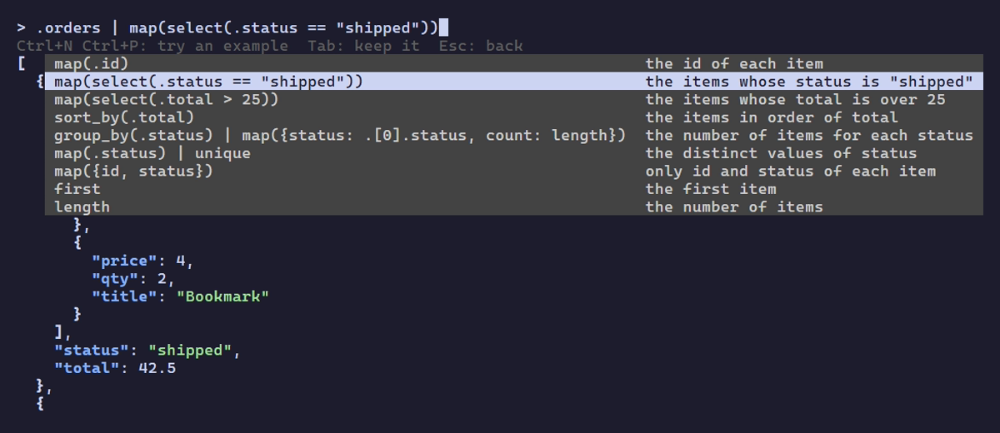

# jitto

[](https://github.com/ibuki-aizawa/jitto/actions/workflows/ci.yml)
[](https://github.com/ibuki-aizawa/jitto/releases/latest)
[](go.mod)
[](LICENSE)

**English** | [日本語](README.ja.md)

**Interactive jq with autocomplete from your actual data.**

See the result as you type, pick keys that are really there — even inside `map()` — and take the finished filter back to your script.

The name comes from the Japanese word *jitto* (じっと), "to stare intently" — as in staring at your JSON until it makes sense.



> 日本語の説明は [README.ja.md](README.ja.md) にあります。Shift_JIS の入力や、PowerShell で日本語を含む JSON を渡す方法は [docs/encoding.ja.md](docs/encoding.ja.md) で説明しています。

## Features

- **Autocomplete from your data**: jitto runs the expression on your JSON and suggests the keys that actually appear there, even inside `.[] | ...` or `map(...)`.
- **Example filters, no AI**: Ctrl+T lists filters that fit the result, such as `map(select(.status == "shipped"))` or `group_by(.status)`, built from your keys and values.
- **Your data stays on your machine**: jitto never connects to the network. No AI service, no telemetry, no update checks. It reads your file or pipe, and nothing leaves your computer, so it is fine for logs and API responses you cannot share.
- **Try before you type**: The result updates on every keystroke, colored like jq. Ctrl+N / Ctrl+P preview each candidate, and the last good result stays while the expression is incomplete.
- **Made for scripts**: Enter prints the result to stdout and the filter to stderr, so you can pipe one and paste the other.
- **One binary, Windows-first**: No jq needed; filters run on [gojq](https://github.com/itchyny/gojq). Works in Windows Terminal, PowerShell and cmd, even with Shift_JIS or UTF-16 input, and on macOS and Linux.

## Demos

Key completion, with a preview of each key:


Example filters with Ctrl+T:


Raw strings with Alt+R, piped to the next command:


## Quick start

```powershell
# Open a file
jitto data.json

# Read from standard input
curl.exe https://example.com/data.json | jitto

# Pass the confirmed result to the next command
jitto data.json | Set-Content result.json

# In PowerShell, pass the JSON text of a web response, not the object
(Invoke-WebRequest https://example.com/data.json).Content | jitto

# Write strings without quotes, like jq -r
jitto -r data.json
```

Type an expression, then press Enter to print the result, or Ctrl+C to quit without output.

## Install

winget support is coming soon.

### From GitHub Releases

1. Download the file for your PC from [Releases](https://github.com/ibuki-aizawa/jitto/releases/latest):
   - `jitto-windows-amd64.exe` for most PCs, with an Intel or AMD processor
   - `jitto-windows-arm64.exe` for Arm PCs, such as those with a Snapdragon processor

   To check, open Settings > System > About and look at "System type".
2. Rename it to `jitto.exe` if you like, and put it in a folder on your PATH.

The executable is not code-signed. When you open it from Explorer for the first time, Windows may show "Unknown publisher"; choose "Run" to continue. To check the download, compare it with `SHA256SUMS` attached to the release:

```powershell
Get-FileHash .\jitto-windows-*.exe
```

### With go install

If you have Go 1.27 or later:

```powershell
go install github.com/ibuki-aizawa/jitto@latest
```

This puts `jitto.exe` in `%USERPROFILE%\go\bin` (or `$GOBIN` if set), which the Go installer adds to your PATH. Use `@v0.3.0` instead of `@latest` to pick a version. It also works on macOS and Linux.

### From source

Requires Go 1.27 or later.

```powershell
git clone https://github.com/ibuki-aizawa/jitto.git
cd jitto
go build -o jitto.exe .
```

## Usage

```
jitto [-r] [--encoding NAME] FILE
COMMAND | jitto [-r] [--encoding NAME]
```

Without `FILE`, jitto reads JSON from standard input. `jitto --version` (`-V`) shows the version and `jitto --help` (`-h`) shows the help.

Type a jq expression in the input at the top; the result appears in the pane below. An empty expression means `.`.

Press Enter to confirm. jitto prints the result to stdout and the expression to stderr, and exits. Only the result flows into a pipe or redirect, and the expression stays on screen. While the expression has an error, Enter does nothing.

### Colors

The result is colored like jq: keys in bold blue, strings in green, `null` in gray, and brackets in bold. On Enter, the result printed to the console has the same colors, and a pipe or file gets plain JSON. Set `NO_COLOR` to turn colors off, or `CLICOLOR_FORCE=1` to keep them in a pipe.

### Raw strings (-r)

With `-r` (`--raw-output`), strings in the result are written as they are, without quotes, as in jq: `"one\ntwo"` becomes two lines, `one` and `two`. Only strings at the top of the result change; arrays, objects and numbers stay JSON.

Press Alt+R to switch `-r` on or off at any time. The result is evaluated again, and the prompt shows `-r> ` while `-r` is on. Enter outputs the result in the mode on screen.

Raw strings have no colors. In the result pane, a tab becomes spaces and other control characters are shown as `^[` (ESC) and the like, so that a string cannot break the screen. stdout gets the string unchanged.

### Key completion

When you start a key, as in `.` or `.items[0].na`, jitto lists the keys available at that point just below what you typed. It finds them by running the expression on your data, so `.[] | .na` and `map(.na` suggest the keys of every element.

- The list is filtered by what you have typed, ignoring case.
- Ctrl+N / Ctrl+P write the candidates into the input one by one, like completion in Vim, and the result pane shows the result of that expression. After the last candidate (or before the first), you are back to what you typed.
- Keep typing, or press Tab / Ctrl+Y, to continue with the candidate. Without a selection, Tab / Ctrl+Y inserts the first candidate.
- Esc restores what you typed and closes the list.
- Keys that need quotes, such as `a-b`, are inserted as `."a-b"`.

### Example filters (Ctrl+T)

Press Ctrl+T to list filters that can follow the expression, each with what it gives. jitto makes them from the result: its types, keys and values. For `.orders` in the [demo data](demo/demo.json), the list starts like this:

| Example | Description |
|---|---|
| `map(.id)` | the id of each item |
| `map(select(.status == "shipped"))` | the items whose status is "shipped" |
| `map(select(.total > 25))` | the items whose total is over 25 |
| `sort_by(.total)` | the items in order of total |
| `group_by(.status) \| map({status: .[0].status, count: length})` | the number of items for each status |

- For an array of objects, the examples pick out a key (`map(.name)`), filter (`select`), sort (`sort_by`), count by a key (`group_by`), or keep a few keys (`map({id, name})`). `select` and `group_by` use a key with a few distinct strings and its most common value, or a number key and its median.
- For an array of numbers or strings, they add up, average, sort or count the values (`add`, `add / length`, `unique`, `join(", ")` and so on). For an object, they go into its keys (`.orders`, `keys`, `to_entries`).
- When the expression yields several values, as `.[] | .name` does, some examples collect them first: `[.[] | .name] | unique`.
- Each example is run on your data first. One that fails, gives nothing, or changes nothing is left out.

Ctrl+N / Ctrl+P write the examples into the input, after ` | `, and the result pane previews each one, as with key completion. After the last one, you are back to what you typed. Tab / Ctrl+Y keeps the example (or inserts the first one), and Esc, or Ctrl+T again, restores what you typed. Editing keeps the example and closes the list.

An expression that ends with a pipe, such as `.orders |`, gets the examples after its pipe.

### Keys

| Key | Action |
|---|---|
| Enter | Print the result and exit |
| Ctrl+C | Exit without output |
| Ctrl+T | List example filters for the result (again to close) |
| Alt+R | Switch `-r` (raw strings) on or off |
| ↑ ↓ | Scroll the result by one line |
| PgUp PgDn | Scroll the result by one page |
| Shift+← Shift+→ | Scroll the result sideways |
| Ctrl+N Ctrl+P | Write the next / previous candidate or example into the input and preview it |
| Tab Ctrl+Y | Accept the candidate or example (or insert the first one) |
| Esc | Close the candidates or examples (restoring what you typed; candidates stay closed until you edit) |
| Ctrl+W (Alt+Backspace) | Delete the word before the cursor |
| Alt+D (Alt+Delete) | Delete the word after the cursor |
| Ctrl+← Ctrl+→ (Alt+B Alt+F) | Move by word |
| ← → etc. | Edit the input |

The mouse wheel also scrolls the result.

On macOS, Alt+R works only when the terminal sends Option as Meta: in Terminal, turn on "Use Option as Meta key" in the profile's Keyboard settings; in iTerm2, set the Option key to "Esc+".

A word is a run of key characters (letters, digits, `_`) or a run of symbols. In `.items[0].name`, Ctrl+W deletes only `name` and leaves `.items[0].`, so you can pick another key.

## Encodings

jitto reads UTF-8, and UTF-16 with a BOM. For Shift_JIS, add `--encoding sjis`. The output is always UTF-8.

Piping non-ASCII text in PowerShell needs some settings, and so does piping the response of `Invoke-WebRequest`. See [docs/encoding.md](docs/encoding.md) for those and the details of each encoding.

## Details

- With multiple JSON documents (such as NDJSON), the expression applies to each document, as in jq.
- Key completion examines up to 10,000 values, lists up to 1,000 keys, and stops after 1 second.
- Example filters examine up to 10,000 values, list up to 10 examples, and stop after 1 second.
- The preview shows up to 1 MiB, and evaluation stops after 5 seconds. Enter evaluates without these limits and prints the whole result. If it takes long, edit the expression to cancel, or press Ctrl+C to quit.
- jitto draws the screen on stderr, so stderr cannot be redirected.

### Exit codes

| Code | Meaning |
|---|---|
| 0 | Confirmed and printed the result |
| 1 | Cannot read the file, invalid JSON, stderr redirected, etc. |
| 2 | Invalid usage |
| 130 | Canceled with Ctrl+C |

## Limitations

Most differences from jq come from gojq.

- Object keys are printed in sorted order; the input order is not kept.
- These are not available: `keys_unsorted`, `$__loc__`, `debug`, `stderr`, `input_filename`, `input`, `inputs`.
- Of the jq command-line options, only `-r` is available. Others, such as `-c` and `-j`, are not.
- Input must be UTF-8, UTF-16 with a BOM, or Shift_JIS (`--encoding sjis`). See [docs/encoding.md](docs/encoding.md).
- Results nested deeper than 10,000 levels cannot be shown.
- Non-identifier keys need quotes, as in jq: `."名前"`. Typing `.名前` shows the correct form with the error.

Key completion:

- Only object keys are suggested, not array indexes such as `[0]` or `[]`.
- Inside quotes (`."na`), no candidates are shown. After `.`, candidates with quotes appear.
- Inside an unfinished `if` (until `end`) or `def` (until `;`), as in `if . then .na`, no candidates are shown. After it is closed, as in `if . then . end | .na`, they are.

## License

[MIT](LICENSE)

The jitto executable includes Go and several open-source libraries. Their licenses are in `THIRD_PARTY_NOTICES.txt`, attached to each release.
